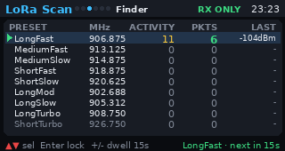
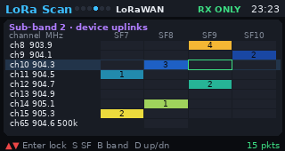
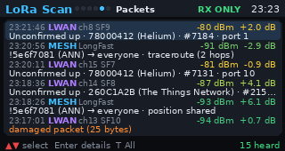
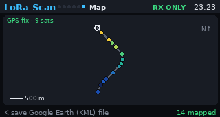
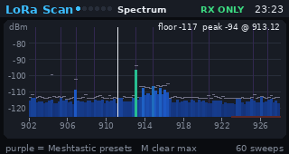
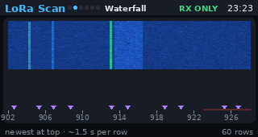

# LoRa Scanner for CardputerZero

A **receive-only** LoRa scanner and packet decoder for the M5Stack CardputerZero with the **Cap LoRa-1262**. It shows what's on the air in the US 902–928 MHz band, decodes Meshtastic and LoRaWAN packets, and, using the Cap's GPS, maps where you heard them.

 
 
 

**It never transmits.** The radio driver has no transmit command, so it's safe to leave running anywhere.

## Pages

| # | Page | What it does |
|---|---|---|
| 1 | Spectrum | Signal level across 902–928 MHz (~1.5 s per sweep), max-hold, and markers at each Meshtastic preset's frequency |
| 2 | Waterfall | The last couple of minutes of sweeps, newest at the top |
| 3 | Finder | Listens on each Meshtastic preset in turn and decodes the **public default channel**: text messages, node names and hardware, battery and weather telemetry, shared positions (rounded), traceroutes |
| 4 | LoRaWAN | Hops the US915 channels of a sub-band at SF7–SF10 (or the gateway downlink channels) and decodes **LoRaWAN headers**: device address, network (The Things Network, Helium…), frame counter, port and flags, and **join requests** with the device's EUI and maker |
| 5 | Packets | Everything heard, newest first. **Enter** shows every decoded field plus a hex dump. **T** filters Meshtastic / LoRaWAN |
| 6 | Map | **Coverage map:** each packet is a dot where you were when you heard it, colored by signal strength, with your path in grey. **K** saves a Google Earth (KML) file |

## Keys

The arrows printed on the Cardputer's keys work as arrows: **F** ▲, **X** ▼, **Z** ◀, **C** ▶. (The ; . , / keys and real arrow keys also work.)

| Key | Action |
|---|---|
| ◀ ▶ (the Z / C keys), Tab, or 1–6 | Change page |
| ▲ ▼ (the F / X keys) | Select (preset, channel, packet) or scroll |
| Enter | Finder / LoRaWAN: lock onto the selected preset or channel. Packets: open details |
| + / − | Time spent on each preset / channel |
| S | LoRaWAN: listen on one spreading factor (or all) |
| B | LoRaWAN: change sub-band (2 is the one The Things Network and Helium use in the US) |
| D | LoRaWAN: switch between device uplinks and gateway downlinks |
| T | Packets: show all / Meshtastic / LoRaWAN |
| K | Map: save a KML file to `~/LoRaScan/` |
| ESC or Q | Quit (or close the packet details) |

The Packets and Map pages keep listening with whichever you used last, the Finder or the LoRaWAN page.

## What you can and can't see

- **Meshtastic:** packets on a preset's default public channel use a key everyone knows, so they're decoded just as any Meshtastic node would show them. **Private channels and direct messages stay encrypted.** The app shows only who sent them and to whom.
- **LoRaWAN:** the headers are readable: device address, network, frame counter, port and the device EUI in join requests. **The data inside is encrypted** with keys only the device's owner has.
- **Coverage:** your own position is only stored on the device, in `~/LoRaScan/packets.csv` and the KML files you save. Positions other Meshtastic users share are shown rounded to about 1 km.

## Tips

- **LoRaWAN is usually the busiest.** Smart meters, parking and farm sensors and Helium/TTN trackers report every few minutes in most towns. Start on the LoRaWAN page with sub-band 2.
- **Gateway downlinks** (D) are transmitted at higher power and can be heard from far away, but they sit at 923–928 MHz, above the Cap's rated 923 MHz, so expect weaker reception there.
- **Meshtastic nodes are quiet.** Give the Finder 30+ minutes, or lock onto LongFast and leave it running.
- **Coverage mapping:** start on the page you want (Finder or LoRaWAN), then switch to Map and go for a drive or walk. A KML file is also saved automatically when you quit.

## Files

- `~/LoRaScan/packets.csv`: every packet: time, frequency, SF, RSSI, SNR, protocol, decoded summary, your position (when there's a GPS fix) and the raw bytes in hex.
- `~/LoRaScan/coverage-YYYY-MM-DD_HHMM.kml`: coverage maps for Google Earth.

Copy them to a PC with `scp "YOURUSER@DEVICE-IP:~/LoRaScan/*" .`

## Only one LoRa app at a time

The radio can only be used by one program at a time. If a Meshtastic app (such as `meshtasticd` or PocketMesh) is running, LoRa Scanner says so when it starts. Close that app first, then open the scanner.

## Install

```
scp pocket-lorascan_1.1.0-rev1_arm64.deb YOURUSER@DEVICE-IP:~/
ssh YOURUSER@DEVICE-IP
sudo apt install ~/pocket-lorascan_1.1.0-rev1_arm64.deb
sudo reboot
```

The reboot applies the permissions it needs: group membership for SPI, GPIO, I²C and the GPS serial port, plus a boot-time entry (`/usr/lib/tmpfiles.d/pocket-lorascan.conf`) that lets the `gpio` group switch on the Cap's power.

## Technical notes

- SX1262 on `/dev/spidev0.1`, BUSY GPIO 22, RESET GPIO 26 (gpiochip0), 3.0 V TCXO on DIO3, DIO2 as RF switch. The antenna switch is PI4IOE5V6408 P0 at I²C bus 1, address 0x43, and the Cap's 5 V rail is `ext_5v_out`. GPS NMEA comes in on `/dev/ttyS0` at 115200 baud.
- **Meshtastic:** sync word 0x2B, 16-symbol preamble, preset frequencies from Meshtastic's slot formula (djb2 hash of the preset name). Decryption is AES-128-CTR with the default key, using a nonce of packet id (64-bit LE) + sender (32-bit LE) + zeros. AES is implemented in the app itself (checked against the FIPS-197 test vector), so no extra packages are needed.
- **LoRaWAN:** sync word 0x34, 8-symbol preamble. Uplinks: 902.3 + 0.2·n MHz (125 kHz, SF7–10) plus one 500 kHz channel per sub-band. Downlinks: 923.3 + 0.6·n MHz (500 kHz, SF7–12, inverted IQ, no CRC). The network comes from the NetID encoded in the device address.
- Pure Python, with no packages beyond Pillow and NumPy.

License: MIT.
